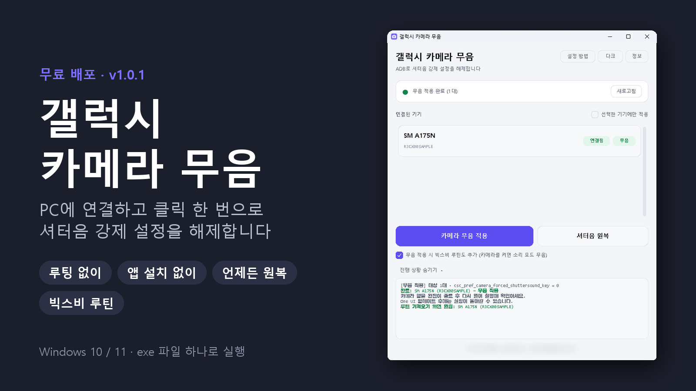
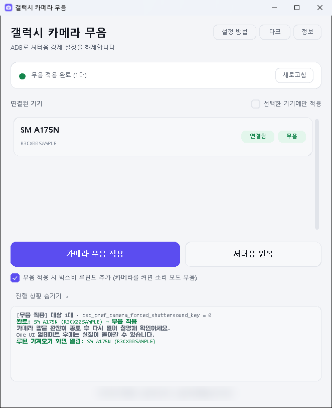
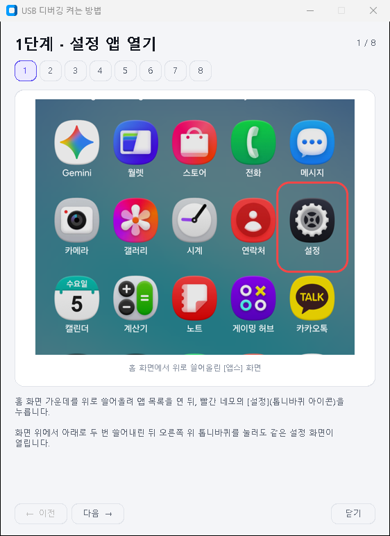
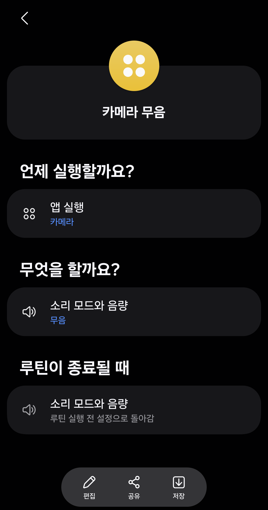

# 갤럭시 카메라 무음



ADB로 삼성 갤럭시의 **카메라 셔터음 강제 설정을 해제**하는 윈도우용 GUI 툴입니다.
연결된 기기를 자동으로 찾아 한 번에 적용하고, 원래대로 되돌릴 수도 있습니다.

## 다운로드

**[Releases](../../releases/latest)** 에서 `GalaxyCameraMute.exe` 를 받아 실행하세요.
설치도, Python도 필요 없습니다. (Windows 10 / 11)

사진이 들어간 자세한 사용설명서: **[Wiki](../../wiki)** (인쇄용 PDF는 [Releases](../../releases/latest)에 있습니다)

> 처음 실행할 때 'Windows의 PC 보호' 창이 뜨면 **[추가 정보] → [실행]** 을 누르세요.
> 서명되지 않은 개인 제작 exe라서 나오는 경고입니다.

| 메인 화면 | 설정 방법 안내 | 휴대폰 루틴 저장 |
|---|---|---|
|  |  |  |

실제로 보내는 명령은 아래 한 줄입니다.

```
adb shell settings put system csc_pref_camera_forced_shuttersound_key 0
```

`0` = 무음, `1` = 셔터음 원복. 루팅이 필요 없고, 앱을 설치하지도 않습니다.

## 특징

- **자동 감지** — 케이블을 꽂으면 4초 안에 목록에 뜨고, 뽑으면 바로 사라집니다
- **여러 대 일괄 적용** — 연결된 모든 기기에 한 번에. 원하는 기기만 골라서도 가능
- **현재 상태 표시** — 기기마다 지금 무음인지 셔터음이 켜져 있는지 보여줍니다
- **적용 후 검증** — 값을 다시 읽어 확인하므로 조용히 실패하지 않습니다
- **빅스비 루틴 함께 추가** — "카메라를 켜면 소리 모드 무음, 끄면 원래대로" 루틴을
  휴대폰의 '모드 및 루틴' 앱에 바로 띄워줍니다 (휴대폰에서 [저장]만 누르면 됨)
- **사진 안내** — USB 디버깅 켜는 법을 실제 갤럭시 화면 스크린샷 8단계로 안내.
  인증이 안 된 기기가 보이면 자동으로 뜹니다
- 다크 / 라이트 테마

## 설치와 실행

**배포본을 쓰는 경우**: `GalaxyCameraMute.exe` 를 더블클릭하면 끝입니다.
Python도, 설치도 필요 없습니다.

**소스로 실행하는 경우**: Windows, Python 3.10 이상이 필요합니다.
`카메라 무음 툴 실행.bat` 더블클릭 — 필요한 구성요소를 자동으로 받아옵니다.

직접 실행하려면:

```bat
pip install -r requirements.txt
py main.py
```

## 사용법

### 1. 휴대폰 준비 (처음 한 번만)

1. **설정 → 폰 정보 → 소프트웨어 정보 → 빌드번호**를 7번 연타 → "개발자 모드를 켰습니다"
2. **설정 → 보안 및 개인정보 보호 → 보안 위험 자동 차단**을 **끄기** (아래 [자동으로 켜기]도 함께)
3. **설정 → 개발자 옵션 → USB 디버깅** 켜기
4. 케이블로 PC 연결 → 휴대폰의 **"USB 디버깅을 허용하시겠습니까?"** 에서 **허용**

> **2번을 건너뛰면 USB 디버깅 스위치가 잠겨 켜지지 않습니다.**
> 삼성 '보안 위험 자동 차단'에 *USB 케이블로 전달되는 명령 차단*이 들어 있기 때문입니다.
> [자동으로 켜기]를 끄지 않으면 **30분 뒤 자동으로 다시 켜져** 연결이 끊깁니다.

막히면 툴 상단의 **[설정 방법]** 버튼을 누르세요. 위 과정을 실제 화면 사진으로 보여줍니다.

### 2. 적용

기기가 목록에 뜨면 **[카메라 무음 적용]** 클릭. 끝입니다.

- 기본값은 **연결된 모든 기기에 일괄 적용**
- 특정 기기만 하려면 **[선택한 기기에만 적용]** 을 켜고 카드를 눌러 선택
- **[셔터음 원복]** 을 누르면 값이 `1`로 돌아가 다시 소리가 납니다
- **[무음 적용 시 빅스비 루틴도 추가]** (기본 켜짐) — 무음 적용에 성공하면 휴대폰에
  '카메라 무음' 루틴 화면이 열립니다. 휴대폰 화면 아래 **[저장]** 을 눌러야 추가됩니다.
  원복할 때 루틴은 자동으로 지워지지 않으니 '모드 및 루틴' 앱에서 직접 삭제하세요.

### 3. 마무리

카메라 앱을 완전히 종료 후 다시 열어 촬영해 확인하세요.
확인했으면 휴대폰의 **USB 디버깅과 개발자 옵션은 다시 꺼두는 것**이 좋습니다.

> One UI를 업데이트하면 설정이 초기화될 수 있습니다. 그때는 다시 적용하면 됩니다.

## 구성

```
갤럭시 카메라 무음/
├─ 카메라 무음 툴 실행.bat    실행 런처
├─ main.py                    엔트리포인트
├─ ui_main.py                 메인 윈도우
├─ ui_guide.py                설정 방법 안내 창
├─ ui_about.py                정보 · 라이선스 창
├─ ui_widgets.py              공통 위젯 조각
├─ ui_theme.py                색 팔레트
├─ adb_core.py                adb 실행 · 기기 목록 · 설정 읽기/쓰기
├─ appinfo.py                 앱 메타 정보
├─ guide_steps.py             안내 단계 텍스트
├─ guide/                     안내용 스크린샷 (01~08.png)
├─ licenses/                  제3자 라이선스 전문 (exe에 내장)
├─ routine/camera_mute.rtn    빅스비 루틴 파일 (exe에 내장)
├─ manual/                    사용설명서 PPTX·PDF (source/: 다시 만드는 스크립트)
├─ docs/images/               README용 이미지
├─ dev_preview.py             개발용: 실기기 없이 가상 기기로 화면 확인
├─ app.ico
├─ build_portable.bat         단일 exe 빌드
├─ requirements.txt
├─ LICENSE                    저작권 · 이용 조건 (수정·재배포 금지)
└─ THIRD-PARTY-NOTICES.md     제3자 라이선스 고지
```

`platform-tools`(adb) 폴더가 있으면 그것을 쓰고, 없으면 첫 실행 때
Google 공식 서버에서 내려받습니다. PATH에 adb가 있으면 그것도 사용합니다.

## 빌드 (포터블 단일 exe)

`build_portable.bat` 실행 → `build_portable\GalaxyCameraMute.exe` 하나가 만들어집니다.

공식 배포는 **이 파일 하나**로 합니다. 설치도, Python도, 추가 파일도 필요 없습니다.
(직접 빌드한 exe는 확인용으로만 쓰고 다시 배포하지 마세요 — [라이선스](#라이선스) 참고)
안내 이미지와 라이선스 전문까지 exe 안에 들어 있고, 라이선스는 프로그램의
**[정보] → [라이선스 전문 보기]** 에서 확인할 수 있습니다.

**Nuitka**로 파이썬 코드를 C로 컴파일해 네이티브 바이너리를 만듭니다.
복원 가능한 `.pyc` 가 들어 있지 않아 역설계가 훨씬 어렵습니다.
(다만 어떤 방식이든 완전한 보호는 불가능합니다.)

adb는 동봉하지 않습니다. 첫 실행 때 Google 공식 서버에서 받아 **exe 옆에** 저장하므로
USB 메모리에 넣고 다녀도 그대로 동작합니다. (쓰기가 막힌 위치라면 `%LOCALAPPDATA%` 로 대체)

## 문제 해결

| 증상 | 확인할 것 |
|---|---|
| **USB 디버깅 스위치가 안 켜짐** | **보안 및 개인정보 보호 → 보안 위험 자동 차단** 끄기 (+ [자동으로 켜기]도) |
| 잘 되다가 갑자기 기기가 사라짐 | 자동 차단이 30분 뒤 다시 켜졌을 가능성이 큽니다 |
| 목록이 비어 있음 | 케이블 연결, USB 디버깅 활성화. USB 연결 모드를 "파일 전송"으로 변경 |
| `USB 디버깅 미승인` | 휴대폰의 허용 팝업에서 **허용**. 안 뜨면 케이블 재연결 |
| `오프라인` | 케이블 재연결, 또는 개발자 옵션 → **USB 디버깅 권한 승인 취소** 후 다시 연결 |
| 적용은 됐는데 소리가 남 | 카메라 앱 완전 종료 후 재실행. 그래도 나면 재부팅 |
| 루틴 화면이 안 뜸 | 휴대폰 잠금을 풀어보세요. 그래도 안 되면 `내 파일 → Download → GalaxyCameraMute.rtn` 을 직접 열기 |
| Python을 찾을 수 없음 | [python.org](https://www.python.org/downloads/)에서 설치 ("Add python.exe to PATH" 체크) |

## 라이선스

```
Copyright (c) 2026 최승훈. All rights reserved.
https://gwchoi.com · gwchoi96@gmail.com
```

**소스 코드는 투명성을 위해 공개하지만, 오픈소스가 아닙니다.** ([LICENSE](LICENSE))

| 해도 되는 것 | 허락 없이 하면 안 되는 것 |
|---|---|
| 공식 exe를 본인 기기에 개인적으로 사용 | 수정하거나 이를 바탕으로 만든 프로그램을 배포·공유 |
| 소스 코드 열람, 본인 PC에서 빌드해 동작 확인 | 원본·수정본을 다른 사이트·커뮤니티에 다시 올리기 |
| 이 저장소 링크 공유 | 상업적 이용, 저작자 표시 삭제 |

허락이 필요하면 gwchoi96@gmail.com 으로 문의해 주세요.

함께 쓰이는 제3자 구성요소는 각자의 라이선스를 따르며
[THIRD-PARTY-NOTICES.md](THIRD-PARTY-NOTICES.md) 에 정리했습니다. 요약하면:

| 구성요소 | 라이선스 | 배포 시 |
|---|---|---|
| CustomTkinter | MIT | 고지 포함 — exe의 [정보] 창에 내장 |
| Pillow | MIT-CMU | 고지 포함 — exe의 [정보] 창에 내장 |
| darkdetect | BSD 3-Clause | 고지 포함 — exe의 [정보] 창에 내장 |
| Python / Tcl-Tk | PSF · Tcl-Tk | 고지 포함 — exe의 [정보] 창에 내장 |
| Zstandard (zstd) | BSD 3-Clause | 고지 포함 — exe의 [정보] 창에 내장 |
| Nuitka 런타임 | AGPLv3 + 런타임 예외 | 예외 조항에 따라 exe를 저작자 라이선스로 배포 가능 |
| adb (Platform-Tools) | Apache 2.0 (AOSP) | **동봉하지 않음** — 사용자가 Google에서 직접 내려받음 |
| 안내 스크린샷 | 삼성전자 UI | 사용법 설명 목적 |

모두 허용형 라이선스라 저작자 코드에 별도의 공개·라이선스 의무를 지우지 않습니다.

본 소프트웨어는 삼성전자 및 Google과 제휴 관계가 없습니다.

## 주의

본인 소유 기기에 사용하세요. 한국에서 카메라 셔터음은 법으로 강제된 규격이 아니라
**이동통신 사업자 자율 규약(TTA 표준)** 에 따른 것이라 설정 변경 자체가 불법은 아니지만,
**타인의 동의 없는 촬영은 성폭력처벌법 등으로 처벌될 수 있습니다.**
그로 인해 발생하는 문제에 대해 저작자는 책임지지 않습니다.
